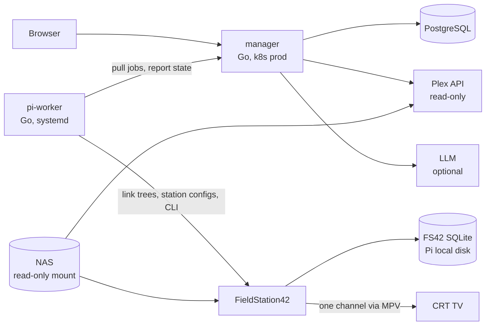

# Architecture

## Components



| Component | Owns | Must not own |
|---|---|---|
| Plex adapter | Fetching metadata: items, versions, parts, file paths | Schedules; any write to Plex |
| Catalog | Media identity, metadata snapshots, path mappings | Original files |
| Prompt interpreter (LLM) | Draft channel definitions | Files, credentials, commands, playback |
| Resolver / compiler | Deterministic membership; FS42 config and link plan | Active state; unvalidated native options |
| pi-worker | Link trees, local validation, native builds, activation, rollback | LLM access; arbitrary commands; NAS writes |
| FS42 | Native catalog, schedule, playback, sequence state | Channel definitions |

The manager and PostgreSQL run in the homelab `prod` cluster ([ADR-0001](adr/0001-control-plane-on-homelab-k8s.md)). The CRT Pi runs FS42 and the worker only. The worker pulls jobs, so the Pi accepts no inbound connections. Playback must never depend on the manager, Plex or the LLM.

## Catalog and identity

- Identity comes from Plex metadata, never from directory names. `ratingKey` is server-scoped and can change after a rescan. GUIDs can be missing or shared. Never merge items on title alone.
- Model: source → library → item (show / season / episode / movie) → versions → ordered parts. A membership references an item plus its chosen version and part. Many memberships can share one file.
- One single-part version per item, picked deterministically: supported container/codec, then operator preference, then a stable tie-breaker. Multipart-only items are reported and excluded.
- Only a complete, successful sync marks unseen items unavailable. Partial syncs never remove anything. History is kept.
- Metadata sync never scans the NAS.
- Times are stored as UTC instants, with original air dates kept separately. Durations are integer milliseconds, converted once at the FS42 boundary.

## Path mapping

The `internal/pathmap` package doc covers the translation rules. On the Pi, the worker separately checks that each mapped target:
- is a readable regular file;
- has a canonical path under an allowlisted root that is actually mounted (mount table or sentinel file, not directory existence);
- doesn't escape through a symlink.

## Channel definitions

A channel is a versioned application JSON document (not FS42 JSON) with:
- display name, channel number and timezone (which must equal the Pi's timezone);
- **pools**: filters (kind, genre, year range, …) plus include and exclude IDs;
- **programming blocks**: which pool is eligible on which days and hours.

Rules:
- Strict schema; unknown fields are rejected.
- All seven days covered by non-overlapping, hour-aligned blocks. `24:00` is valid only as an end time.
- Exclusions always win. Includes bypass theme filters only, never availability or kind checks.
- Title mentions resolve to catalog IDs through deterministic search. Ambiguous titles return candidates; missing titles are reported.
- FS42 controls actual airing (slot rounding, filler, rotation). Rules it can't honour come back as `unsupported_constraints` and need confirmation. Never drop them silently.
- Reviewed revisions are immutable, and edits create new revisions. A channel's FS42 network key never changes.

## Generated FS42 artifacts

```text
/var/lib/fs42-manager/generations/<gen>/channels/<channel>/<revision>/
    <pool>/<title>--<id>.<ext>   -> /mnt/nas/...   (file symlink, never a directory)
    bump/<filler>.<ext>          -> operator filler
```

- One content root per channel revision. Never share a root across channels: FS42 would suppress overlapping airings.
- See [fs42-integration.md](fs42-integration.md#media-links) for naming and layout rules.
- Trees are immutable. FS42 schedules embed absolute link paths, so keep a tree while any retained DB or backup references it.

## Activation

1. **Prepare:** take the per-device lock. Verify the expected active revision, FS42 version, free space, NAS mounts and clock. Build link trees and preflight every target.
2. **Preview:** build the candidate in an isolated workspace. The operator reviews the generated schedule.
3. **Approve:** the operator accepts the preview digest and a short restart.
4. **Quiesce:** record the current channel number. Stop the FS42 player, schedule agent, API and builds. Leave the display stack running.
5. **Snapshot and build:**
   - `.backup` the live DB into a new candidate workspace and check its integrity.
   - Copy unmanaged configs verbatim.
   - Rebuild changed managed stations only.
   - Verify that unmanaged rows are unchanged.
6. **Promote:**
   - Back up the live DB, configs and player state.
   - Replace the DB by same-filesystem copy plus rename.
   - Remove the WAL/SHM files.
   - Remap the saved channel index.
7. **Start and verify:** restart the services that were running. Mark the revision active only after the worker verifies playback and coverage.
8. **Rollback** on any failure: restore the backup the same way, restart and verify. Never report a failed rollback as success.

Journal every step so a crash or reboot can be reconciled. FS42-level details: [fs42-integration.md](fs42-integration.md#activation-and-backups).

## Control-plane API (planned)

| Method | Path | Purpose |
|---|---|---|
| POST | `/v1/sync-runs` | Start a scoped Plex sync |
| GET | `/v1/media` | Paginated catalog search |
| POST | `/v1/channel-drafts` | Prompt → validated draft, clarifications, warnings |
| PUT | `/v1/channel-drafts/{id}` | Manual edits (optimistic concurrency) |
| POST | `/v1/channel-drafts/{id}/resolve` | Freeze definition and membership |
| POST | `/v1/revisions/{id}/preview` | Queue a candidate build |
| GET | `/v1/jobs/{id}` | Job state, redacted log, result |
| POST | `/v1/deployments` | Approve an exact preview digest (idempotency key, expected active revision) |
| POST | `/v1/deployments/{id}/rollback` | Restore the previous revision |
| GET | `/v1/devices/{id}/status` | Worker health, mounts, FS42 version, active revision, coverage |

States: `draft → resolved → previewing → ready → approved → deploying → active`, or `failed` / `rolled_back`. All write endpoints require authentication. The worker has its own device credential.
